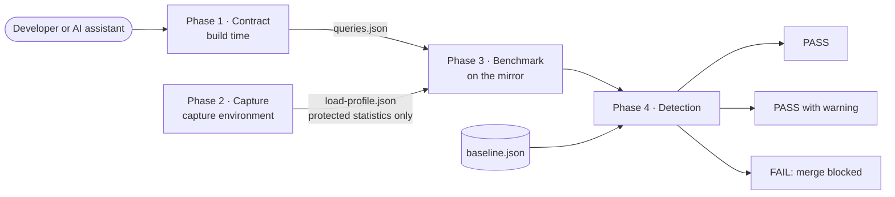

# CPT-SQL: Continuous Performance Testing for SQL Queries

CPT-SQL is the reference implementation, in Java, of a methodology that checks every pull request against **performance contracts declared next to the code**, whoever wrote the change. Its core is a **mirror database generated only from production statistics protected with differential privacy**, so no production record enters the CI pipeline. A **risk-aware gate** blocks a merge only when a query nears its latency budget, and a **nightly run** at five times the volume anticipates degradations caused by data growth.

See [sql-testing-demo](https://github.com/Alizeci/sql-testing-demo) for a complete e-commerce case study that consumes this framework, including the evaluation data.

## How it works



1. **Contract (build time).** The developer annotates each method that executes a SQL query. `@SqlQuery` assigns it an identifier and `@Req` declares its performance contract. An annotation processor extracts the contracts into `queries.json`. The annotations have source retention, so they add no runtime cost.

   ```java
   @SqlQuery(queryId = "searchProductsByCategory",
             description = "Search active in-stock products")
   @Req(maxResponseTimeMs = 300,
        priority = Req.Priority.HIGH,
        allowPlanChange = false,
        description = "Backed by idx_products_category.")
   public List<Product> searchByCategory(String category) { ... }
   ```

   `@Req` attributes and defaults: `maxResponseTimeMs` (1000), `priority` (`MEDIUM`), `allowPlanChange` (`true`; set it to `false` to enable plan-change detection) and `description`.

2. **Capture (capture environment).** A driver-level interceptor records the SQL text and latency of each instrumented query. At the end of the capture, the same environment computes a small statistical summary of whole tables: means and dispersions of declared numeric columns, value frequencies of declared categorical columns, and, for each foreign key, a concentration curve of related records per parent. Every statistic is protected with the Gaussian mechanism of differential privacy. The output, `load-profile.json`, contains no production record or identifier.
3. **Benchmark (every pull request).** The engine provisions an isolated PostgreSQL mirror in Docker, generates synthetic data from the summary with a fixed seed, replays the captured load, and collects each query's latency distribution and estimated plan cost.
4. **Detection (every pull request).** The detector evaluates four criteria. Blocking findings return a non-zero exit code that stops the merge.

| Criterion | Fires when | Default threshold | Action |
|---|---|---|---|
| `P95_EXCEEDED` | The p95 exceeds the declared SLA | `maxResponseTimeMs` | Blocks |
| `SLO_PROXIMITY` | The p95 is within the SLA but close to it | 80% of the SLA | Blocks |
| `PLAN_CHANGED` | The estimated plan cost grows against the baseline and the contract sets `allowPlanChange = false` | Cost +20% over the baseline | Blocks if the p95 uses 50% of the SLA or more, otherwise warns |
| `BASELINE_EXCEEDED` | The p95 grows against the last approved measurement | +10% and at least +10 ms | Warns |

Relative criteria compare the pull request against a baseline measured on the same kind of mirror after every merge. The baseline records the load profile and volume it was measured with; if they do not match the current run, relative criteria are skipped and the baseline is reported as `INCOMPATIBLE`.

## Modules

| Module | Contents |
|---|---|
| `sql-testing-annotations` | `@SqlQuery`, `@Req` and the annotation processor that writes `queries.json` |
| `sql-testing-domain` | Shared models (`LoadProfile`, `BenchmarkResult`, `DegradationReport`, `ValidationReport`) |
| `sql-testing-infrastructure` | Driver-level capture, differentially private release, synthetic data generator, benchmark engine, detector and database dialects (`BenchmarkMain` is the entry point) |

## Requirements

- Java 17
- Docker (the mirror runs in a PostgreSQL 17 container)
- PostgreSQL for the capture environment. Only PostgreSQL 17 has been validated.
- A self-hosted GitHub Actions runner with Docker, for the CI workflows

## Installation

The artifacts are not published to Maven Central. Publish them to your local Maven repository, on every machine that builds the consuming application (including the CI runner):

```bash
git clone https://github.com/Alizeci/CPT-SQL.git
cd CPT-SQL
git checkout v1.0.0
./gradlew publishToMavenLocal
```

Then, in the consuming project (Gradle):

```groovy
repositories { mavenLocal(); mavenCentral() }

dependencies {
    compileOnly         'escuelaing.edu.co:sql-testing-annotations:1.0.0'
    annotationProcessor 'escuelaing.edu.co:sql-testing-annotations:1.0.0'
    implementation      'escuelaing.edu.co:sql-testing-domain:1.0.0'
    implementation      'escuelaing.edu.co:sql-testing-infrastructure:1.0.0'
}
```

## Configuration

Spring properties, usually in `application.properties`. Only `loadtest.mirror.schema.script` is required.

### Detector

| Property | Default | Criterion |
|---|---|---|
| `loadtest.detector.sloProximityPct` | `0.80` | `SLO_PROXIMITY` |
| `loadtest.detector.planCostTolerancePct` | `0.20` | `PLAN_CHANGED` |
| `loadtest.detector.planChangeSlaRiskThresholdPct` | `0.50` | `PLAN_CHANGED` (block vs. warn) |
| `loadtest.detector.baselineTolerancePct` | `0.10` | `BASELINE_EXCEEDED` |
| `loadtest.detector.baselineMinDeltaMs` | `10` | `BASELINE_EXCEEDED` (absolute floor) |

Start lenient and tighten once the run-to-run noise of your runner is known. The case study used `baselineTolerancePct=0.50` because its runner varied by about ±9% between runs.

### Mirror and benchmark

| Property | Default | Purpose |
|---|---|---|
| `loadtest.mirror.schema.script` | required | DDL of the consuming application |
| `loadtest.mirror.host`, `port`, `db`, `user`, `password`, `container` | see `application.properties` of the demo | Mirror container |
| `loadtest.synthetic.rowsPerTable` | `500` | Synthetic rows per table (the case study used 400,000 per pull request and 2,000,000 nightly) |
| `loadtest.synthetic.seed` | `42` | Generator seed. A fixed seed makes the mirror byte-identical across runs |
| `loadtest.benchmark.testProfile` | `light` | `light` (pull requests), `normal` (nightly), `peak`, `sustained`, `wave` |
| `loadtest.benchmark.statementTimeoutMs` | `60000` | Per-statement timeout. A cancelled query is recorded at the timeout, as a severe degradation |
| `loadtest.baseline.path` | | Path to `baseline.json` (set by the workflows) |
| `loadtest.profile.path` | | Path to `load-profile.json` (set by the workflows) |
| `loadtest.fidelity.validationRuns` | `50` | Iterations per query in the fidelity check (never blocks) |
| `loadtest.sla.complianceThresholdPct` | `95.0` | Minimum share of operations within the SLA |

### Differential privacy (capture)

Read from environment variables by the capture step.

| Variable | Default | Purpose |
|---|---|---|
| `CPT_DP_EPSILON_NUMERIC` | `0.6` | Budget for numeric means and dispersions |
| `CPT_DP_EPSILON_CATEGORICAL` | `0.4` | Budget for categorical frequencies |
| `CPT_DP_EPSILON_FK` | `0.4` | Budget for foreign-key concentration curves (`0` disables them) |
| `CPT_DP_DELTA` | `1e-6` | δ of the Gaussian mechanism |
| `CPT_DP_BOUNDS` | | Clipping bounds, e.g. `price:0:600,rating:0:5`. Numeric columns without bounds are suppressed |
| `CPT_DP_CATEGORICAL` | | Categorical columns to release, e.g. `products.category,orders.status` |

Choose bounds from domain knowledge, never from the captured data. Privacy is defined per record.

## Reusable CI workflows

Consuming repositories call these workflows with `uses: Alizeci/CPT-SQL/.github/workflows/<file>@v1.0.0`. All run on a `self-hosted` runner.

| Workflow | Typical trigger in the consumer | Purpose |
|---|---|---|
| `light-benchmark.yml` | Pull request | Gate: 400,000 rows per table, `light` profile (10 TPS, 60 s measurement) |
| `update-baseline.yml` | Push to `main`, or after a capture | Measures and commits `baseline.json` |
| `nightly-benchmark.yml` | Schedule | Checks every query against its SLA at 2,000,000 rows, `normal` profile (100 TPS, 120 s measurement) |
| `capture-production-profile.yml` | Manual | Runs the capture and commits the protected `load-profile.json` |

Secrets expected by the capture and gate workflows: `DB_URL`, `DB_USER`, `DB_PASSWORD` (the capture database).

## Other database engines

Engine-specific code sits behind the `DatabaseDialect` interface. `PostgresDialect` is the validated implementation. `MysqlDialect` is a skeleton that declares the methods still to be adapted (`bulkInsert`, `parsePlanCost`, `parsePlanRootNode`) and is not wired into the pipeline.

## Limitations

The generator treats columns as independent and assumes that a parent's popularity is the same across child tables. The engine replays queries on a single thread, so it does not exercise contention. Privacy is defined per record, so an entity with many records is less protected than the budget suggests.

## Known issues

These do not affect the evaluated scenarios and are planned for a later release.

- A query that fails only on SLA compliance (below `loadtest.sla.complianceThresholdPct`), with no blocking criterion, prints a `FAIL` verdict but the process exits with code 0.
- The REST endpoints of `CaptureToggle` and `CaptureWindowOrchestrator` are declared as non-static inner classes and may not be registered by Spring. Captures run through the CI workflow are not affected.
- `TableProfiler` keys released numeric statistics by column name, so two bounded columns with the same name in different tables overwrite each other. Use distinct names or declare bounds for only one of them.
- The debugging path `loadtest.synthetic.seedRealRows=true` can fail on foreign-key constraints, because real rows are inserted before synthetic parent rows exist.

## Versions

| Tag | Commit | Meaning |
|---|---|---|
| `tg-runs-2026-10` | `aedf43f` | Exact version used in the evaluation runs of the master's final project and the article |
| `v1.0.0` | | First release. Adds a fix to the `elapsedMs` field of the latency time series, which does not affect percentiles or verdicts |
| `archive/*` | | Historical branches kept for reference |

## Citation

Izquierdo Castro, L. A. (2026). *Diseño y desarrollo de un sistema de pruebas de carga continua para consultas SQL durante el ciclo de vida del software* [Master's degree final project]. Escuela Colombiana de Ingeniería Julio Garavito.

## License

Copyright 2026 Laura Alejandra Izquierdo Castro and Escuela Colombiana de Ingeniería Julio Garavito.

[Apache License 2.0](LICENSE.txt). See [`NOTICE`](NOTICE).
