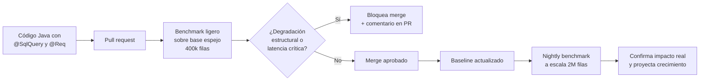

# CPT-SQL: Continuous Performance Testing for SQL Queries

Framework Java para detección continua de degradaciones de rendimiento
en consultas SQL, integrado con pipelines de CI/CD.

Opera a lo largo del ciclo de vida del software: desde la declaración
del contrato de rendimiento en tiempo de compilación, la captura de
tráfico real en producción, la validación pre-merge en cada pull request
y la confirmación a escala mediante benchmarks nocturnos.

## Cómo funciona



1. El desarrollador declara el contrato de rendimiento directamente
   en el código Java:

   ```java
   @SqlQuery(queryId = "searchProductsByCategory")
   @Req(maxResponseTimeMs = 300, priority = HIGH)
   public List<Product> searchProducts(String category) { ... }
   ```

2. En cada pull request, CPT-SQL ejecuta un benchmark ligero sobre una
   base de datos espejo poblada con datos sintéticos privados y compara
   el resultado contra el baseline aprobado.

3. Si el plan de ejecución cambia estructuralmente o la latencia se
   acerca al SLA declarado, el pipeline bloquea el merge y publica un
   comentario en el pull request explicando la degradación detectada.

4. Un benchmark nocturno a escala productiva (2M filas) confirma que
   las degradaciones se materializan a volumen real y proyecta el
   comportamiento futuro ante el crecimiento orgánico de los datos.

## Arquitectura

Tres módulos Maven independientes:

- **`sql-testing-annotations`** — contrato declarativo (`@SqlQuery`, `@Req`)
  procesado en tiempo de compilación.
- **`sql-testing-domain`** — modelos de dominio compartidos (LoadProfile,
  BenchmarkResult, DegradationReport, ValidationReport).
- **`sql-testing-infrastructure`** — ejecución operativa: captura JDBC,
  benchmark, detección y dialecto de motor.

## Requisitos

Java 17+ · PostgreSQL 14+ · Docker · Maven o Gradle

## Instalación

```xml
<dependency>
  <groupId>escuelaing.edu.co</groupId>
  <artifactId>sql-testing-annotations</artifactId>
  <version>1.0.0</version>
</dependency>
<dependency>
  <groupId>escuelaing.edu.co</groupId>
  <artifactId>sql-testing-domain</artifactId>
  <version>1.0.0</version>
</dependency>
<dependency>
  <groupId>escuelaing.edu.co</groupId>
  <artifactId>sql-testing-infrastructure</artifactId>
  <version>1.0.0</version>
</dependency>
```

## Configuración

Propiedades Spring en `application.properties`. Solo
`loadtest.mirror.schema.script` es obligatorio; el resto tiene
defaults calibrados.

### Detector de degradaciones

Los cuatro umbrales que gobiernan el gate del pipeline. Todos se
prefijan con `loadtest.detector.`.

| Propiedad | Default | Criterio | Qué hace |
|---|---|---|---|
| `baselineTolerancePct` | 0.10 | `BASELINE_EXCEEDED` | Cuánto puede subir el p95 vs. `baseline.json` antes de disparar una advertencia |
| `planCostTolerancePct` | 0.20 | `PLAN_CHANGED` | Cuánto puede aumentar el costo del plan antes de disparar el criterio estructural |
| `sloProximityPct` | 0.80 | `SLO_PROXIMITY` | Fracción del SLA a partir de la cual se activa el bloqueo preventivo |
| `planChangeSlaRiskThresholdPct` | 0.50 | `PLAN_CHANGED` | Fracción del SLA a partir de la cual un `PLAN_CHANGED` bloquea el merge |

### Otras propiedades

| Propiedad | Default | Qué hace |
|---|---|---|
| `loadtest.mirror.schema.script` | requerido | Ruta al DDL del esquema del consumidor |
| `loadtest.synthetic.rowsPerTable` | 400000 | Filas sintéticas por tabla del esquema espejo |
| `loadtest.synthetic.seed` | autogenerado | Semilla del generador; fijarla garantiza reproducibilidad byte-idéntica |
| `loadtest.fidelity.validationRuns` | 50 | Iteraciones por consulta en la validación de fidelidad |
| `loadtest.sla.complianceThresholdPct` | 0.95 | Fracción mínima de operaciones dentro del SLA para veredicto PASS |

## Workflows CI/CD reutilizables

| Workflow | Disparador | Propósito |
|---|---|---|
| `light-benchmark.yml` | Pull request | Gate proactivo con perfil ligero (400k filas, 30s) |
| `nightly-benchmark.yml` | Cron nocturno | Validación a escala productiva (2M filas, 120s) |
| `update-baseline.yml` | Post-merge | Actualiza `baseline.json` con el resultado de la rama principal |
| `capture-production-profile.yml` | Manual | Captura de perfil de tráfico real desde producción |

## Extensión a otros motores

El framework aísla los puntos motor-dependientes tras la interfaz
`DatabaseDialect` (10 métodos organizados en aprovisionamiento,
inserción masiva y análisis de planes). La implementación de referencia
es `PostgresDialect`; `MysqlDialect` se distribuye como esqueleto no
integrado en el pipeline actual.

## Ejemplo de uso

Ver el proyecto de referencia [sql-testing-demo](https://github.com/Alizeci/sql-testing-demo),
que implementa un e-commerce Java con seis consultas anotadas y los
cuatro workflows CI/CD integrados.

## Documentación académica

Especificación técnica completa disponible en el Trabajo de Grado:

> Izquierdo Castro, L. A. (2026). *Diseño y desarrollo de un sistema
> de pruebas de carga continua para consultas SQL durante el ciclo
> de vida del software*. Escuela Colombiana de Ingeniería Julio Garavito.

## Licencia

Distribuido bajo [Apache License 2.0](LICENSE.txt). Ver [`NOTICE`](NOTICE)
para atribuciones específicas.
